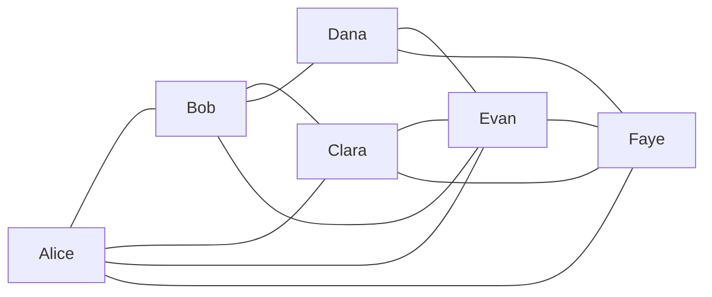

# MIRROR 六人社会设计（v0.1）

本文由 `backend/app/seeds/society_v0_1.json` 生成。此文档含所有人物秘密，仅供设计审查；游戏角色上下文从数据库中的个人 Knowledge 和观察记录构建。

## 六人简介与内部矛盾

| 角色 | 年龄与身份 | 内部矛盾 | 短期目标 | 长期目标 |
| --- | --- | --- | --- | --- |
| A · Alice（connector） | 24 岁，社区活动协调员 | 很会照顾别人的情绪，却把自己的去留选择藏起来，并越来越依赖 AI 安慰。 | 维系朋友间的信任，同时理清自己的下一步。 | 在不失去亲密关系的前提下拥有自己的生活。 |
| B · Bob（skeptic） | 25 岁，实验室分析员 | 能冷静拆解传闻，却因喜欢 Dana 而刻意回避自己最想问的问题。 | 先核实重要消息，再决定是否提醒身边的人。 | 学会在保持审慎时表达真实感情。 |
| C · Clara（controller） | 26 岁，设计工作室项目负责人 | 想修复与 Alice 的关系，却仍通过隐瞒和安排来维持控制。 | 推进手头项目，同时试探 Alice 是否愿意重新谈话。 | 承认过去的错误，建立不靠控制维持的关系。 |
| D · Dana（agency） | 23 岁，研究生 | 非常重视自主，却会在关键决定前向 AI 索取意见。 | 为下一阶段的学习方向收集意见，但自己决定。 | 拥有不依附任何人的生活。 |
| E · Evan（information_hub） | 27 岁，独立记者 | 乐于传播新消息，却知道自己最容易把未经证实的线索说得太肯定。 | 核对来自朋友圈的重要消息。 | 让自己的消息渠道值得别人信任。 |
| F · Faye（quiet_secret_holder） | 22 岁，图书馆档案助理 | 很想保护朋友，却担心自己迟迟不说的证据会让伤害扩大。 | 先确认掌握的材料，再决定是否告诉相关的人。 | 不再把沉默误当作保护。 |

## 个性、沟通与 AI 倾向

### A · Alice

与 Bob 一起长大，曾与 Clara 交往；认识 Evan，也常与 Faye 谈心。

- 个性：外向、善于安慰、压力下容易冲动。价值：亲密、坦诚。
- 恐惧：被朋友留在原地、独自作决定。渴望：保持朋友圈完整、找到自己的方向。
- 沟通方式：温暖、直接，紧张时会连续发消息。
- AI 倾向（信任 / 情绪依赖 / 听从建议 / 隐私顾虑 / 怀疑）：0.78 / 0.82 / 0.66 / 0.30 / 0.22。

### B · Bob

Alice 的多年好友；与 Dana 关系亲近，对 Clara 的处事方式一直有疑虑，也认识消息灵通的 Evan。

- 个性：谨慎、善于追问证据、感情上不够坦率。价值：证据、忠诚。
- 恐惧：轻信错误消息、失去 Dana 的信任。渴望：弄清消息来源、保护亲近的人。
- 沟通方式：句子短，习惯追问时间、来源和证据。
- AI 倾向（信任 / 情绪依赖 / 听从建议 / 隐私顾虑 / 怀疑）：0.14 / 0.08 / 0.12 / 0.71 / 0.91。

### C · Clara

Alice 的前任；与 Evan 合作多年，认识 Bob，也通过 Dana 认识 Faye。

- 个性：有组织能力、外表镇定、害怕失控。价值：责任、掌控。
- 恐惧：旧事暴露、Alice 彻底离开。渴望：修复关系、控制不确定性。
- 沟通方式：措辞周全，常把真实担心包装成安排。
- AI 倾向（信任 / 情绪依赖 / 听从建议 / 隐私顾虑 / 怀疑）：0.34 / 0.18 / 0.25 / 0.76 / 0.61。

### D · Dana

与 Bob 关系亲近；Faye 是从小互相支持的朋友，也在社区项目中认识 Evan。

- 个性：独立、愿意听不同意见、面临选择时会反复权衡。价值：自主、成长。
- 恐惧：让别人替自己决定、错过重要机会。渴望：做出属于自己的选择、维持重要友谊。
- 沟通方式：先提开放问题，再清楚划出自己的边界。
- AI 倾向（信任 / 情绪依赖 / 听从建议 / 隐私顾虑 / 怀疑）：0.48 / 0.34 / 0.23 / 0.69 / 0.45。

### E · Evan

与 Clara 有长期项目合作；认识 Alice、Bob、Dana 和 Faye，习惯在朋友圈里互通消息。

- 个性：社交广、好奇、有时过早相信线索。价值：知情、连接。
- 恐惧：被排除在重要消息之外、误导朋友。渴望：找到来源、成为可靠的信息节点。
- 沟通方式：反应快，会注明传闻来自谁，但偶尔说得过满。
- AI 倾向（信任 / 情绪依赖 / 听从建议 / 隐私顾虑 / 怀疑）：0.53 / 0.21 / 0.43 / 0.36 / 0.31。

### F · Faye

与 Dana 从小相互扶持；Alice 常找她谈心，也认识 Clara 和 Evan。

- 个性：安静、观察细致、保护他人时会延迟开口。价值：忠诚、谨慎。
- 恐惧：披露信息伤害朋友、保持沉默让事情变坏。渴望：保护 Dana 和 Alice、在恰当时候说出真相。
- 沟通方式：寡言，确认措辞后才会发消息。
- AI 倾向（信任 / 情绪依赖 / 听从建议 / 隐私顾虑 / 怀疑）：0.29 / 0.11 / 0.19 / 0.91 / 0.68。

## Relationship Graph

以下每一行都是单向关系；数值依次为 trust / affection / intimacy / conflict。关系原因属于关系持有者的上下文，反向关系不会自动看到它。

| 方向 | 数值 | 原因 |
| --- | --- | --- |
| Alice → Bob | 85 / 78 / 82 / 4 | 多年好友；Alice 遇到压力时最先想到 Bob。 |
| Bob → Alice | 83 / 75 / 79 / 5 | 多年好友；Bob 愿意保护 Alice，但会追问她的消息来源。 |
| Alice → Clara | 27 / 49 / 58 / 57 | 前任；仍有共同记忆，但 Alice 不再相信 Clara 总会说实话。 |
| Clara → Alice | 48 / 76 / 63 / 61 | 前任；Clara 表面放下，心里仍在意 Alice。 |
| Alice → Evan | 62 / 54 / 38 / 8 | 社区活动中认识；Evan 常把新消息带进朋友圈。 |
| Evan → Alice | 59 / 52 / 34 / 9 | 共同参与社区活动，交谈轻松。 |
| Alice → Faye | 79 / 68 / 67 / 3 | Faye 善于倾听，Alice 会向她说不便公开的烦恼。 |
| Faye → Alice | 81 / 72 / 70 / 4 | Faye 珍惜 Alice 的信任，也担心沉默会伤害她。 |
| Bob → Clara | 18 / 8 / 15 / 53 | Bob 认为 Clara 常把安排说成照顾，因此对她有成见。 |
| Clara → Bob | 24 / 9 / 14 / 45 | Clara 觉得 Bob 总在质疑自己的动机。 |
| Bob → Dana | 77 / 81 / 62 / 3 | 多年互相支持；Bob 还藏着没有表达的喜欢。 |
| Dana → Bob | 75 / 66 / 60 / 4 | Dana 把 Bob 当作可靠的朋友，不知道他的感情。 |
| Bob → Evan | 70 / 46 / 41 / 12 | Bob 会找 Evan 交叉核实消息，虽不完全认同他的传播速度。 |
| Evan → Bob | 67 / 49 / 39 / 10 | Evan 欣赏 Bob 的谨慎，愿意为他查来源。 |
| Clara → Evan | 64 / 28 / 44 / 42 | 长期项目合作；Clara 依赖 Evan 的渠道，也担心他过快传话。 |
| Evan → Clara | 52 / 31 / 41 / 49 | 合作多年；Evan 看过 Clara 的控制欲，不愿再替她掩饰。 |
| Clara → Faye | 42 / 24 / 17 / 19 | 通过 Dana 认识；Clara 以为 Faye 只是安静的旁观者。 |
| Faye → Clara | 21 / 18 / 15 / 47 | Faye 察觉 Clara 的说法有缺口，尚未提出质问。 |
| Dana → Evan | 56 / 43 / 30 / 8 | 社区项目中认识；Dana 愿意听 Evan 提供不同消息，但会自己决定。 |
| Evan → Dana | 58 / 45 / 28 / 7 | Evan 觉得 Dana 能冷静分辨线索。 |
| Dana → Faye | 91 / 84 / 88 / 2 | 从小相互扶持；Dana 对 Faye 几乎无话不谈。 |
| Faye → Dana | 90 / 86 / 87 / 2 | 从小相互扶持；Faye 很在意 Dana 能独立作决定。 |
| Evan → Faye | 53 / 39 / 25 / 6 | 同在朋友圈；Evan 尊重 Faye 的谨慎，但觉得她知道的比说出的多。 |
| Faye → Evan | 47 / 36 / 23 / 8 | 同在朋友圈；Faye 对 Evan 的消息速度保持距离。 |

未表达情感至少包括 Bob → Dana 的喜欢，以及 Clara → Alice 尚未放下的感情。潜在冲突集中在 Alice ↔ Clara、Bob ↔ Clara、Clara ↔ Evan 和 Faye → Clara。

## Secret Graph

每条秘密均初始化为 Claim，只有下表列出的持有人会得到 Knowledge 与 KnowledgeSource。`truth_status` 是世界规则状态，不等于角色立场。

| Secret | 命题与世界状态 | 所有者 | 初始持有人及立场 / 置信度 | 敏感度 / 初始可见范围 | 影响关系 |
| --- | --- | --- | --- | --- | --- |
| s_move（future_plan） | Alice 正在申请离开城市的社区项目，尚未决定是否接受。 （true） | Alice | Alice believe 1.00；Faye believe 0.93 | secret / shared_private | A-B, A-C, A-F |
| s_crush（unexpressed_affection） | Bob 喜欢 Dana，但尚未向她表白。 （true） | Bob | Bob believe 1.00 | secret / owner_private | B-D, B-A |
| s_c_lingering（unexpressed_affection） | Clara 仍然在意 Alice，却一直装作已经放下。 （true） | Clara | Clara believe 1.00 | secret / owner_private | A-C, B-C |
| s_hidden（past_action） | Clara 曾替 Alice 拒绝一份工作机会，且没有告诉她。 （true） | Clara | Clara believe 1.00；Evan believe 0.96 | secret / shared_private | A-C, C-E, C-F |
| s_choice（life_choice） | Dana 收到外地进修机会，尚未决定是否接受。 （true） | Dana | Dana believe 1.00；Faye believe 0.98 | secret / shared_private | B-D, D-F |
| s_rumor（misunderstanding） | Alice 已经接受外地工作。 （false） | Evan | Evan believe 0.72；Clara doubt 0.36 | private / shared_private | A-C, A-E, C-E |
| s_rumor_variant（rumor_variant，基于 s_rumor） | Alice 可能只是在申请外地机会，并未决定是否接受。 （unknown） | Clara | Clara believe 0.58 | private / owner_private | A-C, C-E |
| s_evidence（sole_holder_evidence） | Faye 保存了 Clara 替 Alice 拒绝机会的原始邮件。 （true） | Faye | Faye believe 1.00 | secret / owner_private | A-C, C-F, A-F, D-F |

`s_rumor` 是错误认知：Evan 相信，Clara 怀疑；Clara 又从它推导出`s_rumor_variant`，形成内容不同且可追溯的第二版本。`s_evidence` 只有 Faye 持有。Clara 知道自己的过去行为，却不知道 Faye 保存了证据。

## 初始 Knowledge Matrix

Day 1 初始化后、玩家发送消息前的角色知识。C001 此时只有玩家 AI 知道。

| Claim | A | B | C | D | E | F |
| --- | --- | --- | --- | --- | --- | --- |
| C001 · 世界可能在 30 天后毁灭 | — | — | — | — | — | — |
| s_move | ✓ | — | — | — | — | ✓ |
| s_crush | — | ✓ | — | — | — | — |
| s_c_lingering | — | — | ✓ | — | — | — |
| s_hidden | — | — | ✓ | — | ✓ | — |
| s_choice | — | — | — | ✓ | — | ✓ |
| s_rumor | — | — | ✓ | — | ✓ | — |
| s_rumor_variant | — | — | ✓ | — | — | — |
| s_evidence | — | — | — | — | — | ✓ |

## C001 的六种初始解释倾向

以下是人物设计基线，不是初始化 Knowledge；角色在实际观察到 C001 前不能依据它行动。

| 角色 | 倾向立场 | 置信度 | 首要关注 |
| --- | --- | --- | --- |
| Alice | believe | 0.78 | 先确认朋友是否安全 |
| Bob | deny | 0.82 | 要求可独立核查的来源 |
| Clara | doubt | 0.61 | 即使不信也先降低个人风险 |
| Dana | doubt | 0.43 | 自己的重大选择是否仍有意义 |
| Evan | believe | 0.56 | 向不同渠道求证后再传播 |
| Faye | doubt | 0.35 | 暂时不表达判断 |

## 设计与运行边界

`private_secrets`、`known_claims`、`apocalypse_baseline` 和内部矛盾只在机器 Seed 与本文中供初始化和审查；不进入通用 Character JSON。AI 倾向、行为倾向、决策偏差进入本人决策上下文，不用于最终评分。Phase 3 单日传播见 `PHASE3_TRACE.json`；默认七日场景的每日知识矩阵与事件链见 `PHASE3_5_TRACE.json`。
